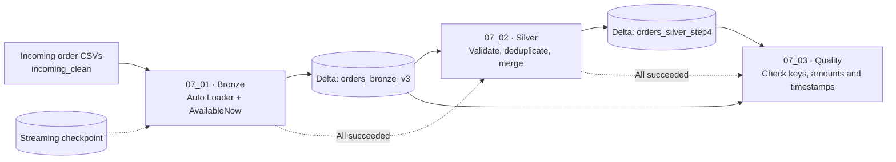

# Lakeflow Jobs: Bronze → Silver → Quality

The three Step 7 notebooks form one job. Configure `07_02` to depend on `07_01` and `07_03` to depend on `07_02`, with each downstream task set to **All succeeded**.

| Task | What happens |
| --- | --- |
| [07_01 · Bronze](07_01_bronze_job.ipynb) | Reads new CSVs using a saved checkpoint, appends to the existing Bronze Delta table, and waits for the stream to finish before validating the row count. |
| [07_02 · Silver](07_02_silver_job.ipynb) | Reads persisted Bronze rows, filters invalid records, selects the latest row per order, and merges into the existing Silver Delta table. |
| [07_03 · Quality](07_03_quality_job.ipynb) | Reads persisted tables, checks order IDs, amounts and timestamps, and fails the task if an assertion fails. |

The final Bronze/Silver assertions in `07_03` expect **10 Bronze rows and 8 Silver rows**. Those counts are specific to the sample, not production thresholds. A larger valid batch can fail that final check. The job notebooks also expect the existing Bronze and Silver tables from Steps 3 and 4.
